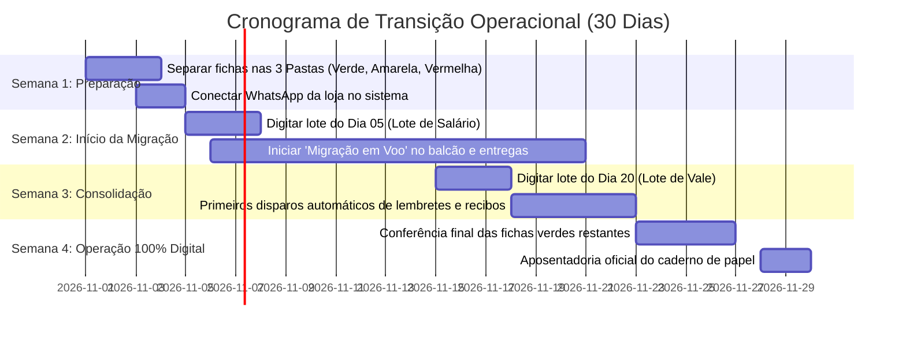

# 📊 Relatório de Mapeamento do Sistema & Manual Prático de Migração de Fichas

**Projeto:** Enxovais Gabriel — Gestão Comercial, Estoque e Crediário Próprio  
**Versão:** 2.0  
**Data:** Outubro de 2026  
**Status do Projeto:** Backend 100% Funcional (47 testes aprovados) | Frontend PWA Integrado | Em Fase de Homologação e Transição Operacional  

---

## 📑 Sumário

1. [Mapeamento Executivo: O Que Já Está Pronto](#1-mapeamento-executivo-o-que-já-está-pronto)
2. [O Que Precisa Ser Concluído ou Refinado](#2-o-que-precisa-ser-concluído-ou-refinado)
3. [Estratégia Prática: Como Facilitar ao Máximo a Migração](#3-estratégia-prática-como-facilitar-ao-máximo-a-migração)
4. [Manual Passo a Passo para Migração de Fichas Antigas de Papel](#4-manual-passo-a-passo-para-migração-de-fichas-antigas-de-papel)
5. [Modelo de Planilha e Dicionário de Dados Facilitado](#5-modelo-de-planilha-e-dicionário-de-dados-facilitado)
6. [Cronograma Sugerido de Transição Sem Estresse (30 Dias)](#6-cronograma-sugerido-de-transição-sem-estresse-30-dias)

---

## 1. Mapeamento Executivo: O Que Já Está Pronto

O sistema do **Enxovais Gabriel** já possui uma infraestrutura completa desenvolvida com rigor de engenharia (TypeScript, Node.js, PostgreSQL e PWA Mobile First). Abaixo está o raio-X detalhado de cada componente construído:

### 🗄️ 1.1 Banco de Dados Relacional (PostgreSQL) — [100% Pronto]
O banco conta com 10 tabelas relacionais com chaves estrangeiras, índices e regras de integridade (localizadas em [`docker/postgres/init.sql`](file:///x:/enxovais%20gabriel/docker/postgres/init.sql)):
* `clientes`: Cadastro com nome, WhatsApp, CPF, endereço, ponto de referência e limite de crédito.
* `produtos`: Catálogo de utilidades e enxovais, SKU, preços à vista e crediário, saldo em estoque e estoque mínimo.
* `fichas_crediario`: Conta-corrente da cliente, saldo devedor acumulado (dividendo), parcela padrão e dia de vencimento (salário ou vale).
* `vendas` & `itens_venda`: Transações comerciais, suporte a pronta-entrega, encomendas e vendas mistas (entrada + crediário).
* `encomendas`: Rastreamento de pedidos feitos aos fabricantes/distribuidores.
* `movimentacoes_ficha`: Extrato auditável e imutável de débitos, pagamentos e estornos.
* `parcelas_crediario`: Cronograma de vencimentos calculados com base no dia fixo da cliente.
* `configuracoes`: Parâmetros de Pix da loja e modelos de texto amigáveis de WhatsApp.
* `logs_mensagens`: Histórico de mensagens disparadas com controle de fila e erros.

### ⚙️ 1.2 Backend e APIs RESTful — [100% Pronto & Testado]
O backend Express + TypeScript possui arquitetura limpa com rotas, controladores e serviços desacoplados:
* **Fichas de Crediário:** Adição de compras ao dividendo, manutenção de parcela combinada, recálculo de prazos, baixa de pagamentos com amortização parcial ou total.
* **Importador CSV Inteligente:** Serviço em [`backend/src/services/importacao.service.ts`](file:///x:/enxovais%20gabriel/backend/src/services/importacao.service.ts) capaz de ler planilhas com tolerância a formatos de colunas, sanitizar números com vírgula ou ponto, validar telefones e gravar em lote tudo em transação atômica (se der erro em uma linha, reverte para evitar dados corrompidos).
* **Fila de WhatsApp Anti-Ban:** Módulo com BullMQ/In-Memory em [`backend/src/queues/whatsapp.queue.ts`](file:///x:/enxovais%20gabriel/backend/src/queues/whatsapp.queue.ts) com delay inteligente entre envios e 3 retentativas para evitar bloqueio do chip da loja.
* **Carnê Digital Web:** Geração de página web responsiva para a cliente consultar no celular suas faturas e chave Pix sem precisar baixar aplicativo.
* **Assistente Lia & Backups:** Inteligência de consulta rápida e exportação compactada de banco de dados e mídias.
* **Qualidade Assegurada:** **47 testes automatizados passando com 100% de sucesso** (`vitest`).

### 📱 1.3 Frontend PWA Mobile & Balcão — [95% Pronto]
* **Design Acolhedor:** Visual limpo, botões grandes para smartphone e paleta afetiva respeitando as diretrizes de usabilidade.
* **Abas Operacionais:**
  1. *Início & Novidades / Tutoriais:* Central de boas-vindas com cards explicativos.
  2. *Cobranças do Dia:* Lista automática de quem vence hoje (dia do pagamento ou vale) com botão de envio direto.
  3. *Fichas & Crediário:* Busca instantânea por cliente, visualização de extrato e botão de registrar pagamento.
  4. *Nova Venda / PDV:* Lançamento rápido de itens à pronta-entrega ou sob encomenda.
  5. *Catálogo & Estoque:* Gestão de produtos, fotos e saldo.
  6. *Clientes:* Cadastro e histórico completo de compras.
  7. *Encomendas:* Painel visual dos itens pedidos a fornecedores.
  8. *Importação de Planilha:* Upload drag-and-drop de CSV com tabela de pré-visualização e validação antes de gravar.
  9. *WhatsApp Gateway:* Indicador de status de conexão com a Evolution API.

---

## 2. O Que Precisa Ser Concluído ou Refinado

Apesar do sistema estar plenamente funcional e operando, identificamos pontos de acabamento e melhorias práticas para garantir excelência no uso diário:

| Área | O Que Falta / Oportunidade de Melhoria | Prioridade | Esforço |
| :--- | :--- | :---: | :---: |
| **Migração das Fichas** | Executar a coleta, conferência e carga das fichas físicas para a base digital usando o método facilitado. | 🔴 Alta | Médio (Processo) |
| **Edição Inline de Erros na Importação** | Na tela de importação CSV, permitir corrigir na própria tabela da tela algum telefone ou nome que tenha vindo incorreto da planilha, sem precisar reabrir o Excel. | 🟡 Média | Baixo (Frontend) |
| **Impressão Térmica Opcional** | Adicionar botão para imprimir comprovante de pagamento em mini-impressoras térmicas Bluetooth (58mm/80mm) para clientes idosas que preferem canhoto de papel. | 🟡 Média | Baixo |
| **Validação da Conexão WhatsApp Real** | Conectar o QR Code da Evolution API na VPS com o aparelho celular de WhatsApp comercial da loja e testar disparos reais. | 🔴 Alta | Baixo (Operacional) |
| **Despesas Operacionais no Caixa** | Adicionar lançamentos de saídas avulsas no caixa diário (ex: despesa de transporte, lanche, pagamento avulso). | 🟢 Baixa | Baixo |

---

## 3. Estratégia Prática: Como Facilitar ao Máximo a Migração

A maior barreira na digitalização de lojas tradicionais é o medo de ter que parar o atendimento para passar centenas de fichas de papel para o computador. 

Para resolver isso, desenhamos o **Método em 3 Trilhas (Sem Estresse)**:

```
┌────────────────────────────────────────────────────────────────────────┐
│               ESTRATÉGIA EM 3 TRILHAS DE MIGRAÇÃO SUAVE                │
├──────────────────────┬─────────────────────────┬───────────────────────┤
│   TRILHA 1 (50%)     │     TRILHA 2 (30%)      │    TRILHA 3 (20%)     │
│  "Migração em Voo"   │   "Lote por Vencimento" │ "Planilha Facilitada" │
│  Ao atender cliente  │   Semana do dia 05 e 20 │   Digitação em bloco  │
└──────────────────────┴─────────────────────────┴───────────────────────┘
```

### Trilha 1: "Migração em Voo" (Just-in-Time) — A Mais Fácil de Todas
* **Como Funciona:** Não tente digitar tudo antes de começar a usar o sistema!
* Quando uma cliente for até o balcão ou chamar no WhatsApp para fazer uma nova compra ou pagar uma parcela:
  1. A vendedora pega a ficha de papel dela.
  2. Em vez de escrever no papel, abre o sistema no celular e clica em **"+ Novo Cliente"**.
  3. Preenche: Nome, WhatsApp, Dia do Vencimento, Saldo que ela deve hoje e Valor da Parcela.
  4. Lança a compra ou o pagamento no sistema.
  5. Pega a ficha de papel antiga, faz um risco verde bonito na diagonal e escreve:  
     **`✅ DIGITALIZADA NO SISTEMA EM DD/MM/AAAA`**.
  6. Guarda a ficha na gaveta de "Fichas Migradas".
* **Resultado:** Em 30 dias de rotina normal, cerca de **60% a 70% das clientes ativas** são migradas sem que ninguém precise fazer hora extra!

### Trilha 2: "Migração por Lote de Vencimento" (Foco no Dinheiro)
* O maior valor do sistema é não esquecer de cobrar quem vence no dia certo.
* **Ação:**
  - 3 dias antes do **Dia 05**: Pegue apenas o maço de fichas das clientes que vencem no dia 05 e digite no sistema.
  - 3 dias antes do **Dia 20**: Pegue apenas as fichas de quem vence no dia do vale (dia 20) e digite no sistema.
* **Vantagem:** O trabalho é fracionado em tarefas pequenas de 30 a 40 minutos.

### Trilha 3: "Importação por Planilha CSV Enxuta"
* Se alguém da equipe ou um familiar tiver facilidade no computador, pode digitar as fichas em uma planilha Excel simples de apenas **5 colunas obrigatórias**.
* O sistema faz o upload e cadastra tudo em 5 segundos!

### 🛑 Regra de Ouro: O Que NÃO Migrar Agora?
* **Fichas com Saldo R$ 0,00 (Quitadas):** Não perca tempo digitando fichas de quem já pagou tudo e não compra há meses. Coloque em uma pasta de "Arquivo Morto". Se essa cliente voltar um dia para comprar, faz-se o cadastro novo na hora em 30 segundos.
* **Dívidas antigas perdidas (mais de 2 ou 3 anos sem contato):** Não misture cadastros inativos na base nova.

---

## 4. Manual Passo a Passo para Migração de Fichas Antigas de Papel

Este roteiro deve ser impresso ou compartilhado com a vendedora/gestora:

### Passo 1: Separar as Fichas em 3 Pastas Físicas
Antes de digitar qualquer coisa, pegue todas as fichas de papel da loja e separe em três montinhos:
1. 🟢 **Pasta Verde (Clientes Ativas com Saldo):** Compraram recentemente e estão devendo parcelas.
2. 🟡 **Pasta Amarela (Fichas Quitadas):** Clientes que quitaram a conta e não têm compras em aberto.
3. 🔴 **Pasta Vermelha (Inativas / Dúvidas):** Fichas sem telefone legível ou de clientes que sumiram.

> **Meta:** Vamos migrar apenas a **Pasta Verde**! A Pasta Amarela e Vermelha ficam arquivadas fisicamente.

---

### Passo 2: O Que Olhar na Ficha de Papel?
A ficha de papel muitas vezes tem várias anotações rasuradas. A vendedora precisa bater o olho e extrair apenas **5 informações vitais**:

```
┌────────────────────────────────────────────────────────┐
│               EXEMPLO DE FICHA DE PAPEL                │
│                                                        │
│ Cliente: Maria das Graças Silva                        │
│ Tel: (18) 99876-5432                                   │
│ Endereço: Rua das Flores, 120                          │
│                                                        │
│ Compras:                                               │
│ 10/02 - Edredom Queen R$ 350,00                        │
│ 15/03 - Jogo de Toalhas R$ 150,00                      │
│                                                        │
│ Pagamentos:                                            │
│ - Pago R$ 100 em 05/03                                 │
│ - Pago R$ 100 em 05/04                                 │
│                                                        │
│ SALDO QUE ELA DEVE HOJE: R$ 300,00                     │
│ PARCELA COMBINADA: R$ 100,00                           │
│ DIA DO VENCIMENTO: Todo dia 05 (Salário)               │
└────────────────────────────────────────────────────────┘
```

**Os 5 dados que vão para o sistema:**
1. **Nome:** `Maria das Graças Silva`
2. **WhatsApp:** `18998765432` (com DDD)
3. **Dia de Vencimento:** `5`
4. **Saldo Devedor Hoje:** `300.00`
5. **Valor da Parcela:** `100.00`
*(Opcional: Nas observações, anote "Edredom Queen e Jogo de Toalhas")*.

---

### Passo 3: Cadastrando no Sistema (Via Tela ou Via Planilha)

#### Opção A — Cadastro Direto no Celular / Computador (1 a 1):
1. No menu lateral, clique em **"📑 Fichas & Crediário"**.
2. Clique no botão verde **"+ Nova Ficha"**.
3. Digite o Nome, Telefone, Dia de Vencimento (ex: 5), Valor da Parcela (ex: 100) e Saldo Inicial Devedor (ex: 300).
4. Clique em **"Salvar Ficha"**. Pronto! O sistema já calcula as parcelas e gera o extrato.
5. Carimbe ou risque a ficha de papel antiga e guarde na pasta de migradas.

#### Opção B — Importação em Lote via Planilha CSV:
1. Baixe o modelo oficial disponibilizado no sistema: [`template_fichas_crediario.csv`](file:///x:/enxovais%20gabriel/docs/template_fichas_crediario.csv).
2. Abra no Excel ou Google Planilhas.
3. Preencha as linhas com os dados das clientes.
4. Salve como arquivo `.CSV`.
5. No sistema, clique na aba **"📥 Importar Fichas"**.
6. Arraste a planilha para a tela. O sistema mostrará um painel de conferência:
   - Quantas estão perfeitas (em verde).
   - Se houver algum telefone com dígito faltando (em vermelho para avisar).
7. Clique em **"🚀 Confirmar e Digitalizar Fichas Válidas"**.
8. Todas as fichas, clientes e parcelas são criados simultaneamente no banco de dados!

---

## 5. Modelo de Planilha e Dicionário de Dados Facilitado

O modelo de planilha oficial já está integrado ao sistema e disponível na pasta [`docs/template_fichas_crediario.csv`](file:///x:/enxovais%20gabriel/docs/template_fichas_crediario.csv).

### Estrutura das Colunas:

| Coluna | Obrigatório? | Exemplo | Para que serve? |
| :--- | :---: | :--- | :--- |
| **`nome`** | **SIM** | Maria das Graças Silva | Nome completo da cliente. |
| **`whatsapp`** | **SIM** | 18998765432 | DDD + Telefone com 9 dígitos (pode ter traço ou parênteses, o sistema limpa sozinho). |
| **`dia_vencimento`** | **SIM** | 5 | Dia do mês em que ela costuma pagar (1 a 31). |
| **`tipo_ciclo`** | Não | `MENSAL_PAGAMENTO` | `MENSAL_PAGAMENTO` (salário) ou `QUINZENAL_VALE` (vale). Padrão é Mensal. |
| **`saldo_devedor_atual`** | **SIM** | 450,00 | Quanto ela está devendo no total na data de hoje. |
| **`valor_parcela`** | **SIM** | 100,00 | Valor da parcela que ela combina pagar por mês. |
| **`endereco`** | Não | Rua das Flores, 120 | Endereço residencial para entregas. |
| **`ponto_referencia`** | Não | Próximo à Padaria Central | Ponto de referência para rota de entrega. |
| **`cpf`** | Não | 123.456.789-00 | CPF (se houver anotado na ficha). |
| **`limite_credito`** | Não | 1000,00 | Limite pré-aprovado (padrão R$ 1.000,00). |
| **`observacoes`** | Não | Comprou Edredom e Toalhas | Histórico ou anotações especiais da cliente. |

---

## 6. Cronograma Sugerido de Transição Sem Estresse (30 Dias)

Para garantir que a equipe adote a ferramenta com tranquilidade e entusiasmo:



### Regras de Sucesso para a Equipe:
1. **Comemore cada ficha migrada:** Cada ficha que entra no sistema é menos tempo gasto somando na calculadora e menos risco de prejuízo.
2. **A cliente vai adorar:** Sempre avise com carinho: *"Dona Maria, agora a loja tem sistema novo! A senhora vai receber o recibinho no seu WhatsApp na hora que pagar, tudo bem certinho e transparente!"*.
3. **Backup diário:** Toda noite, basta um clique no menu lateral **"💾 Baixar Backup"** para guardar uma cópia de segurança de todos os dados no computador da loja.
