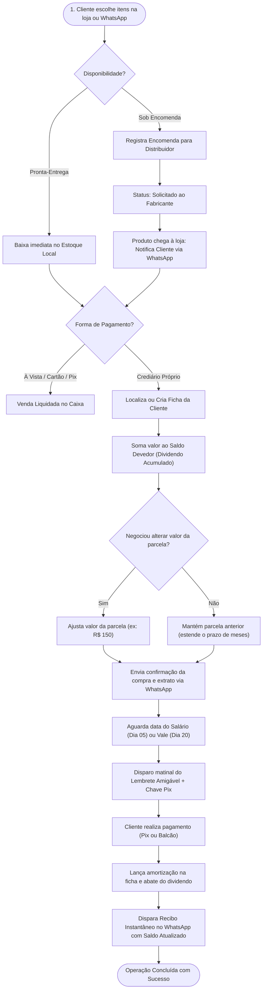

# 📘 Visão Geral, Contexto de Negócio e Utilidades: Enxovais Gabriel

**Projeto:** Sistema Integrado de Gestão Comercial, Estoque e Crediário Próprio  
**Cliente/Empresa:** Enxovais Gabriel  
**Público-Alvo Principal:** Artigos para o Lar, Cama, Mesa, Banho e Utilidades Domésticas  
**Versão do Documento:** 2.0  
**Data de Atualização:** Outubro de 2026  

---

## 📑 Sumário Executivo

1. [Introdução e Propósito do Projeto](#1-introdução-e-propósito-do-projeto)
2. [Contexto de Negócio do Enxovais Gabriel](#2-contexto-de-negócio-do-enxovais-gabriel)
3. [Diagnóstico: Os Problemas que o Projeto Deve Resolver](#3-diagnóstico-os-problemas-que-o-projeto-deve-resolver)
4. [As Utilidades e Módulos do Sistema](#4-as-utilidades-e-módulos-do-sistema)
5. [A Mecânica do Crediário Próprio (O Coração do Negócio)](#5-a-mecânica-do-crediário-próprio-o-coração-do-negócio)
6. [Personas e Benefícios para os Usuários](#6-personas-e-benefícios-para-os-usuários)
7. [Fluxo Operacional de Ponta a Ponta](#7-fluxo-operacional-de-ponta-a-ponta)
8. [Diretrizes de Usabilidade, Linguagem e Humanização](#8-diretrizes-de-usabilidade-linguagem-e-humanização)
9. [Métricas de Sucesso e Indicadores (KPIs)](#9-métricas-de-sucesso-e-indicadores-kpis)

---

## 1. Introdução e Propósito do Projeto

O **Enxovais Gabriel** é um comércio consolidado no segmento de **utilidades domésticas e artigos para o lar**. Seu modelo de negócio é alicerçado na venda de proximidade, no relacionamento de confiança com clientes de bairro e na concessão de **crediário próprio flexível (a tradicional "Ficha de Cliente")**.

### O Propósito Central
O objetivo principal deste projeto de software é **digitalizar, simplificar e profissionalizar toda a engrenagem comercial do Enxovais Gabriel**, substituindo o controle arcaico de cadernos e papéis por uma solução moderna, ágil e focada em dispositivos móveis (smartphones e tablets), sem perder o calor humano, a empatia e a flexibilidade que caracterizam o atendimento da loja.

---

## 2. Contexto de Negócio do Enxovais Gabriel

Para compreender o sistema, é fundamental entender a dinâmica real do negócio:

### 2.1 O que a Loja Vende?
A empresa **não fabrica produtos artesanais**. Ela é uma revendedora comercial que compra de fabricantes e grandes distribuidores parceiros, abrangendo:
* **Cama, Mesa e Banho:** Jogos de lençol, edredons, colchas mateladas, toalhas de banho e rosto, panos de prato e toalhas de mesa.
* **Cozinha e Utilidades Domésticas:** Panelas, jogos de assadeiras, potes herméticos, talheres e utensílios culinários.
* **Decoração e Organização:** Cortinas, tapetes, almofadas, caixas organizadoras e pequenos mimos para o lar.

### 2.2 Duas Modalidades de Disponibilidade:
1. **Pronta-Entrega (Estoque Físico Local):** Itens disponíveis na loja/estoque que o cliente escolhe, compra e leva na hora.
2. **Sob Encomenda (Pedidos aos Distribuidores):** Cores específicas, estampas fora de linha ou produtos maiores que o cliente solicita sob catálogo. A loja realiza o pedido ao fornecedor e avisa o cliente assim que a mercadoria chega.

### 2.3 Formas de Pagamento Oferecidas:
* **À Vista / Imediato:** Pix, Dinheiro em espécie, Cartão de Débito e Cartão de Crédito.
* **Misto:** Entrada em dinheiro/Pix + saldo financiado na ficha.
* **Crediário Próprio (Ficha da Cliente):** A modalidade campeã de vendas, responsável por fidelizar a clientela da região.

---

## 3. Diagnóstico: Os Problemas que o Projeto Deve Resolver

Historicamente, o Enxovais Gabriel gerenciava suas vendas e cobranças em fichas de papel, cadernos manuais e conversas informais de WhatsApp. Esse formato gerou graves gargalos operacionais:

| # | Problema Real Encontrado | Impacto no Negócio | Solução Implementada pelo Projeto |
| :-: | :--- | :--- | :--- |
| **01** | **Cálculo manual de saldo devedor acumulado ("Dividendo")** | Erros de soma, rasuras nas fichas de papel, risco de prejuízo financeiro e desconfiança da cliente. | **Conta-corrente digital automatizada:** cada compra soma ao dividendo e cada pagamento abate com precisão centesimal auditável. |
| **02** | **Cobrança em datas erradas (Desalinhamento do fluxo de renda)** | Cobrar a cliente antes dela receber o salário ou vale gera atrito, constrangimento e perda da janela de pagamento. | **Sincronização de Vencimento:** Fichas cadastradas com a data real do salário (ex: dia 05) ou do adiantamento/vale quinzenal (ex: dia 20). |
| **03** | **Perda física e deterioração de fichas** | Fichas rasgadas, molhadas ou extraviadas no balcão e em rotas de entrega levavam a dívidas esquecidas. | **Banco de dados na nuvem (PostgreSQL) com backup contínuo**, acessível instantaneamente no celular da vendedora. |
| **04** | **Cliente insegura sobre quanto deve e quanto já pagou** | Dúvidas constantes ("Menina, quantas parcelas ainda faltam?", "Você anotou aqueles 50 reais que te dei?"). | **Recibos digitais automáticos no WhatsApp:** Toda amortização envia extrato claro com valor pago e saldo devedor restante. |
| **05** | **Esquecimento de encomendas de fornecedores** | Vendedora prometia trazer um edredom do distribuidor e esquecia de fazer o pedido ou não avisava quando chegava. | **Painel Kanban de Encomendas:** Rastreamento do ciclo (*Solicitada*, *A Caminho*, *Recebida*, *Entregue*) com aviso automático à cliente. |
| **06** | **Lentidão no atendimento do balcão** | Vendedora passava 5 a 10 minutos procurando fichas de papel em pastas sanfonadas enquanto a fila aumentava. | **Busca inteligente por Nome ou WhatsApp em menos de 2 segundos** com interface otimizada para toque. |
| **07** | **Insegurança nas cobranças do dia** | Vendedora precisava folhear dezenas de fichas para saber quem vencia hoje. | **Filtro automático "Vence Hoje"** com geração de mensagem carinhosa e chave Pix Copia e Cola em 1 toque. |

---

## 4. As Utilidades e Módulos do Sistema

O sistema é dividido em **5 módulos integrados**, concebidos para atender tanto a operação rápida no balcão quanto a visão estratégica da gestão:

### 4.1 Módulo de Fichas de Crediário (Conta-Corrente da Cliente)
* **Localização Rápida de Clientes:** Pesquisa por nome, telefone ou endereço residencial/ponto de referência.
* **Extrato Completo de Movimentações:** Linha do tempo transparente com todos os lançamentos:
  - *Débitos de Compras:* Detalhamento dos produtos adquiridos na data.
  - *Créditos de Pagamentos:* Valor pago, data e forma de liquidação.
  - *Estornos ou Ajustes:* Histórico rastreável sem deleção oculta de registros.
* **Controle de Limite de Crédito:** Alerta visual quando o dividendo acumulado se aproxima do teto pré-aprovado da cliente.

### 4.2 Módulo de Catálogo e Controle de Estoque
* **Catálogo Organizado por Departamentos:** *Cama/Mesa/Banho*, *Cozinha*, *Decoração*, *Organização* e *Geral*.
* **Duplo Preço:** Exibição clara do preço à vista (com desconto) e do preço a prazo para o crediário.
* **Baixa Automática:** Ao finalizar venda pronta-entrega, o estoque é atualizado em tempo real.
* **Alerta de Estoque Mínimo:** Aviso preventivo para reposição de itens de alto giro (ex: toalhas avulsas, panos de prato, jogos de lençol padrão).

### 4.3 Módulo de Encomendas aos Distribuidores
* **Vinculação com a Venda:** Permite vender itens sob catálogo mesmo sem saldo em estoque físico.
* **Fluxo de Status Visual:**
  1. 🔵 *Solicitado ao Distribuidor:* Pedido enviado ao fornecedor.
  2. 🚚 *A Caminho:* Mercadoria faturada em transporte.
  3. 📦 *Recebido no Estoque:* Produto conferido na loja.
  4. ✅ *Entregue ao Cliente:* Produto entregue e incorporado à ficha ou liquidado.
* **Gatilho de WhatsApp:** Ao marcar como "Recebido no Estoque", o sistema sugere/dispara mensagem informando a chegada do item.

### 4.4 Módulo de Cobrança e Notificações Humanizadas (WhatsApp)
* **Lembretes Afetuosos de Vencimento:** Disparados na manhã da data acordada (dia do pagamento ou vale) com valor da parcela combinada e chave Pix Copia e Cola em linha destacada.
* **Recibo Instantâneo de Amortização:** Envio automático de comprovante detalhando:
  - Valor recebido hoje.
  - Saldo devedor restante na ficha.
  - Mensagem de agradecimento pela parceria e preferência.
* **Anti-Constrangimento:** Tom respeitoso, sem jargões de cobrança agressiva de instituições bancárias.

### 4.5 Módulo de Caixa e Visão Gerencial
* **Fechamento Diário de Caixa:** Total recebido em dinheiro vivo, Pix, cartões e amortizações de crediário.
* **Relatório de Previsão de Recebíveis:** Projeção de quanto deve entrar no dia 05 (dia do pagamento) e no dia 20 (dia do vale).
* **Termômetro de Inadimplência:** Identificação rápida de fichas com mais de 30 dias de atraso para negociação preventiva.

---

## 5. A Mecânica do Crediário Próprio (O Coração do Negócio)

O grande diferencial competitivo do Enxovais Gabriel é a flexibilidade do crediário em ficha contínua. O sistema foi desenhado para respeitar com exatidão a matemática e a lógica desse modelo:

### 5.1 O Conceito de Dividendo Acumulado
A ficha da cliente funciona como uma conta-corrente cumulativa:
$$\text{Novo Saldo Devedor} = \text{Saldo Anterior} + \text{Novas Compras a Prazo} - \text{Pagamentos Realizados}$$

### 5.2 A Regra da Parcela Fixa Contínua
Diferente de cartões de crédito ou financiamentos bancários rígidos, no Enxovais Gabriel a cliente combina uma **parcela padrão que cabe no bolso** (ex: R$ 100,00 por mês ou R$ 50,00 a cada vale quinzenal).
* **Quando a cliente faz uma nova compra (ex: + R$ 300,00):**
  - O sistema **mantém a parcela de R$ 100,00** e simplesmente **estende o prazo** (adicionando mais 3 meses ao cronograma).
  - A cliente não toma um susto com a parcela dobrando de valor, o que garante a continuidade dos pagamentos sem inadimplência.
* **Poder de Negociação da Vendedora:**
  - Caso a vendedora negocie com a cliente aumentar a parcela (ex: *"Dona Maria, como a senhora comprou mais este edredom, podemos passar a parcela para R$ 150,00 para quitar mais rápido?"*), o sistema permite alterar o `valor_parcela_padrao` e recalcula o número de meses restantes com 1 clique.

### 5.3 O Casamento com o Ciclo Salarial da Cliente
As pessoas pagam quando têm dinheiro em mãos. Por isso, cada ficha possui a configuração expressa do seu ciclo financeiro:
* **Mês Salarial (`MENSAL_PAGAMENTO`):** Vencimento casado com o quinto dia útil ou dia combinado (ex: dia 05 ou dia 10).
* **Vale / Adiantamento (`QUINZENAL_VALE`):** Vencimento casado com a quinzena da empresa onde a cliente trabalha (ex: dia 20).

### 5.4 Pagamentos Parciais (Amortização Flexível)
Se uma cliente deve uma parcela de R$ 100,00, mas no dia só tem R$ 60,00:
* O sistema aceita a amortização de R$ 60,00.
* Abate os R$ 60,00 do saldo devedor total.
* Registra o saldo remanescente daquela parcela (R$ 40,00) sem travar a ficha nem gerar juros abusivos.

---

## 6. Personas e Benefícios para os Usuários

### Persona 1: A Vendedora e Gestora de Atendimento (Ex: Lucelia)
* **Rotina:** Atende no balcão, mostra produtos, negocia no WhatsApp e faz entregas na vizinhança.
* **Dificuldade Antiga:** Passava aperto procurando fichas de papel amassadas e gastava tempo fazendo contas na calculadora.
* **Benefícios do Sistema:**
  - Encontra qualquer ficha em menos de 2 segundos no celular.
  - Adiciona compras e amortizações com 2 toques.
  - Abre a tela matinal e vê de imediato: *"Hoje é dia de vale: 12 clientes para lembrar"*.
  - Envia mensagens prontas e bonitas sem precisar digitar tudo do zero.

### Persona 2: A Cliente do Ateliê (Consumidora do Lar)
* **Rotina:** Dona de casa ou trabalhadora assalariada que gosta de manter sua casa confortável e equipada.
* **Dificuldade Antiga:** Não lembrava quanto já tinha pago, perdia os canhotos de papel e sentia vergonha quando era cobrada em datas que ainda não tinha recebido o salário.
* **Benefícios do Sistema:**
  - Recebe um lembrete carinhoso exatamente no dia em que o dinheiro do seu salário ou vale caiu na conta.
  - Recebe a chave Pix pronta para copiar e pagar pelo aplicativo do banco sem complicação.
  - Ganha na hora um recibo digital no WhatsApp mostrando o valor abatido e o saldo restante da sua ficha, transmitindo total confiança e transparência.

---

## 7. Fluxo Operacional de Ponta a Ponta

O diagrama a seguir ilustra a jornada integrada desde a escolha do produto até a quitação e emissão do recibo:

---

## 8. Diretrizes de Usabilidade, Linguagem e Humanização

Para garantir que o software seja adotado com naturalidade e entusiasmo por toda a equipe, o projeto segue diretrizes rigorosas de design e comunicação:

### 8.1 Princípio "Mobile First" e Agilidade de Balcão
* **Interface Tátil de Alta Resposta:** Botões com altura mínima de 48px, campos com preenchimento assistido e fontes legíveis.
* **Operações em Menos de 3 Toques:** Adicionar uma compra ou dar baixa num pagamento não pode exigir mais de 3 passos na tela.
* **Acessibilidade para Redes Móveis:** Carregamento ultra-rápido mesmo em conexões 3G/4G oscilantes.

### 8.2 Vocabulário Proibido vs Vocabulário Oficial
A linguagem interna e visual deve refletir o comércio acolhedor, eliminando o jargão frio de corporações financeiras:

| ❌ Termo Proibido / Frio | ✅ Termo Oficial Adotado |
| :--- | :--- |
| *Lead / Prospect* | **Cliente / Amiga da Loja** |
| *Contrato de Mútuo / Débito Bancário* | **Ficha de Crediário / Dividendo** |
| *Inadimplente / Negativado* | **Vencimento em Aberto / Pendente** |
| *Amortização Contábil de Passivo* | **Abater da Ficha / Pagamento Parcial** |
| *Ticket Médio / SKU ID* | **Compra / Código do Produto** |

### 8.3 Padrão Cromático dos Status
Para permitir leitura de relance no smartphone:
* 🟢 **Verde Suave:** Ficha em dia ou quitada.
* 🟡 **Dourado / Mostarda:** Vencimento hoje (hora de enviar o lembrete carinhoso de vale ou pagamento).
* 🔴 **Terracota Suave:** Vencimento pendente que requer conversa amigável.
* 🔵 **Azul Cobalto:** Encomenda em trânsito com distribuidor.

---

## 9. Métricas de Sucesso e Indicadores (KPIs)

O sucesso da implementação do projeto é medido pelos seguintes resultados práticos no negócio:

1. **Redução da Inadimplência:** Aumento de mais de **35% nos pagamentos recebidos no dia correto**, devido aos lembretes sincronizados com o dia do vale e do salário.
2. **Tempo de Registro de Operações:** Fechamento de uma compra no crediário ou baixa de pagamento em menos de **30 segundos**.
3. **Erros de Cálculo Zerados:** 100% de precisão nos saldos acumulados e extinção total de divergências de valores com as clientes.
4. **Previsibilidade Financeira:** A administração passa a saber com exatidão quantos reais estão programados para entrar no caixa no dia 05 e no dia 20 de cada mês.
5. **Satisfação e Fidelização:** Aumento da percepção de profissionalismo e confiança das clientes ao receberem recibos instantâneos e organizados via WhatsApp.
